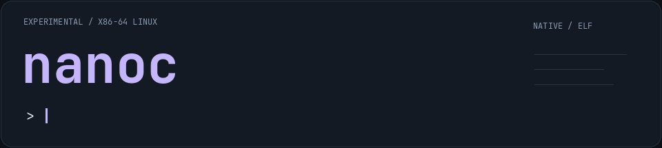

<p align="center">
  
</p>

<p align="center">
  <strong>Small C compiler. Native ELF backend. Written in <a href="https://github.com/yasakei/neutron-rs">Neutron</a>.</strong><br>
  <sub>Experimental · Linux x86-64 · MIT</sub>
</p>

## Quick start

Requires **Linux x86-64**, `ntsc`, and `arq`. Default executable linking uses
`cc`; native linking requires glibc and its dynamic loader.

```sh
arq build

# Compile and run
./build/debug/nanoc -run hello.c

# Native linking — no cc, as, ld, or ar
./build/debug/nanoc --native-link -pie hello.c -o hello
./hello
```

## Usage

```sh
nanoc -E input.c                       # preprocess
nanoc -S input.c -o input.s            # assembly
nanoc -c input.c -o input.o            # native ELF object
nanoc input.c other.o -o program       # default host linking
nanoc --native-link input.c -lm -o app # native executable
nanoc --native-link -run input.c args  # run with arguments
```

Use `./build/debug/nanoc` if it is not on your `PATH`.
Include/macro/library flags: `-I dir`, `-D NAME=value`, `-U NAME`, `-L dir`, `-lname`.
Place archives after their users; put compiler flags before the source with `-run`.

## What works

- C preprocessing, pointers, arrays, structs/unions, initializers, and control flow.
- 64-bit integers, floating point/long double, varargs, and System V aggregate ABI.
- Native ELF objects, archives, PIE, GOT relocations, and libc/shared-library imports.
- Weak/common/absolute symbols, protected data, TLS, and constructors/destructors.

**Native linking is opt-in. Unsupported inputs error out—never silently fall back.**
This is a tested subset, not full C or GNU linker compatibility. C++, VLAs,
thin archives, large-model GOT relocations, and weak TLS imports remain unsupported.

## Tests & details

```sh
arq test
```

Tests compare with GCC and exercise native paths with the host toolchain hidden.
See the [compiler reference](docs/compiler.md) for ABI coverage, individual suites,
native-linker limits, and optional TinyCC comparisons.

[MIT license](LICENSE)
